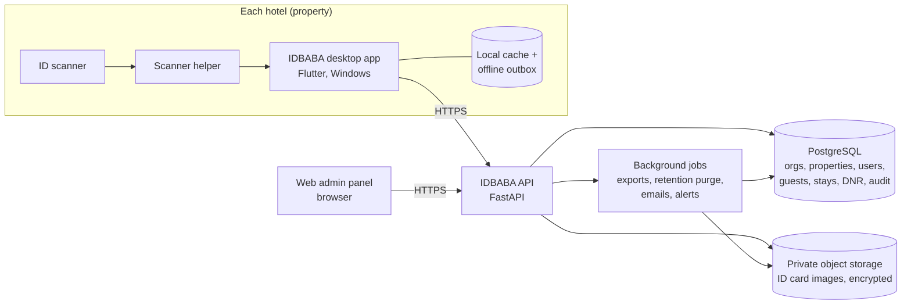
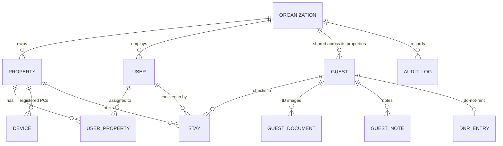
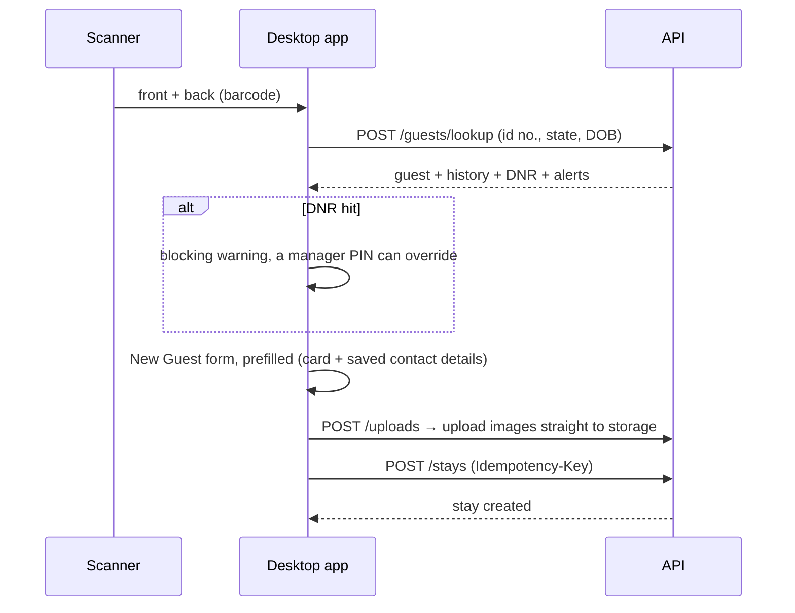

# IDBABA Backend — High-Level Architecture (draft v0.1, 2026-10-11)

**Status:** draft for review. The open questions in §12 change parts of this, so answer them before building.
**Stack (from the plan doc in REQUIREMENTS §5):** FastAPI + PostgreSQL. Two clients use the same API: the **desktop check-in app** (Flutter, Windows) and the **web admin panel**.

---

## 1. What the backend must do

1. **One shared guest database across 6+ hotels.** A guest checked in at Hotel A is recognised at Hotel B: same profile, full stay history, notes and DNR status.
2. **Employees log in.** Every check-in, check-out, edit and view of guest data is tied to a person, not to a PC.
3. **Five roles** (Super Admin, Admin, General Manager, Property Manager, User) with different reach: the whole platform, the organisation, assigned properties, one property, or daily front-desk tasks.
4. **Check-in and check-out** at the front desk, fast, and still working when the internet drops.
5. **The admin panel** manages organisations, properties, users, roles, settings, the DNR list, reports and the audit trail.
6. **Guest data is sensitive** (ID numbers, dates of birth, card images). It is encrypted, access is logged, and it is never written to logs.

---

## 2. System overview



| Part                | Job                                                                                                                                                                                 |
| ------------------- | ----------------------------------------------------------------------------------------------------------------------------------------------------------------------------------- |
| **Desktop app**     | Scans IDs and checks guests in and out. Bound to one property through device registration (§5.3), with employees logging in on top. Keeps a local cache and an offline outbox (§9). |
| **Web admin panel** | Everything else: setup, users, guests, DNR, reports, audit. The same API with role-limited screens.                                                                                 |
| **API**             | Stateless REST/JSON under `/v1`. Enforces tenancy and permissions on **every** request.                                                                                             |
| **PostgreSQL**      | System of record. Every row carries `organization_id`.                                                                                                                              |
| **Object storage**  | ID card images (front, back, photo), in a private, encrypted bucket. Reached only through short-lived signed URLs.                                                                  |
| **Background jobs** | CSV/PDF exports, data-retention purge, invite and reset emails, alert fan-out.                                                                                                      |

---

## 3. Tenancy model



- **Organisation** = a hotel group (the company that owns the 6+ hotels). **Property** = one hotel.
- **Guests belong to the organisation, not to a hotel.** That is what "the DB is shared between hotels" means here: every property in the group sees the same guest. **Stays** belong to a property.
- **Super Admin is above organisations**: it manages organisations and subscriptions. That makes the product multi-tenant SaaS from day one, even if there is only one customer at first (see Q1).
- Isolation: every query is filtered by the caller's `organization_id`, enforced in one place in the API, with PostgreSQL Row-Level Security as a second guard. One organisation can never read another's guests.

---

## 4. Roles & permissions

Roles are **fixed bundles of permissions**. Access to a property comes from **assignment**: a General Manager, Property Manager or User only sees the properties assigned to them.

| Permission                                           | Super Admin |          Admin          |   General Manager   |   Property Manager    |       User        |
| ---------------------------------------------------- | :---------: | :---------------------: | :-----------------: | :-------------------: | :---------------: |
| **Scope**                                            |  all orgs   | own org, all properties | assigned properties |  1 assigned property  | assigned property |
| Organisations, subscriptions, platform settings      |     ✅      |            —            |          —          |           —           |         —         |
| Properties: create / edit                            |     ✅      |           ✅            |          —          |       edit own        |         —         |
| Users: manage                                        |     ✅      |    ✅ (up to Admin)     |          —          | Users in own property |         —         |
| Org settings (retention, age limit, required fields) |     ✅      |           ✅            |          —          |           —           |         —         |
| Register / revoke desktop devices                    |     ✅      |           ✅            |          —          |          ✅           |         —         |
| Scan ID, check in, check out                         |      —      |           ✅            |         ✅          |          ✅           |        ✅         |
| Search guests, view profile + history                |     ✅      |           ✅            |         ✅          |          ✅           |        ✅         |
| Edit guest contact details, add notes                |      —      |           ✅            |         ✅          |          ✅           |        ✅         |
| Edit card-derived fields (name, ID no., DOB)         |      —      |           ✅            |         ✅          |          ✅           |         —         |
| Void a stay                                          |      —      |           ✅            |         ✅          |          ✅           |         —         |
| Mark / lift DNR                                      |      —      |           ✅            |         ✅          |          ✅           |   request only    |
| Override a DNR warning at check-in                   |      —      |           ✅            |         ✅          |          ✅           |         —         |
| Reports and employee activity                        |     ✅      |           ✅            |         ✅          |   ✅ (own property)   |         —         |
| Audit log                                            |     ✅      |           ✅            |      ✅ (read)      |     own property      |         —         |
| Export guest data                                    |     ✅      |           ✅            |         ✅          |           —           |         —         |

- Users can never grant a role above their own. An Admin creates GMs, PMs and Users, not Super Admins.
- The roles brief says the Property Manager works "based on assigned permissions", which suggests per-org tweakable permissions. **v1 ships fixed bundles.** Custom permission sets are a later feature (Q4).
- In code, the API checks **permissions** (`guest.edit_identity`, `dnr.manage`, …), never role names, so the bundles can change later without code changes.

---

## 5. Authentication

### 5.1 Web admin panel

- Email + password, then a **15-minute access token (JWT)** and a **rotating refresh token** in an httpOnly cookie.
- **MFA (TOTP) required** for Super Admin and Admin, optional for the rest (Q8).
- Invite flow: Admin invites by email, and the user sets a password through a single-use link.
- Lockout after 5 failed attempts; every login is audited.

### 5.2 Desktop app — employees on a shared front-desk PC

- The first login on a PC uses email + password. After that, staff **switch user with a 4–6 digit PIN**, which works only on a registered device and only for users assigned to that property.
- Auto-lock after N minutes idle (an org setting).
- Same token model as the web, with refresh tokens bound to the device.

### 5.3 Device registration

- A Property Manager or Admin creates a **one-time enrolment code** in the admin panel. The PC registers with it and receives a **device credential** bound to that property.
- Every desktop request carries **both** the device credential and the user token. A stolen password alone can't check guests in from an unknown PC, and a lost PC can be revoked.

---

## 6. Data model (core tables)

| Table             | Key columns                                                                                                                                                                                                                                  | Notes                                                                      |
| ----------------- | -------------------------------------------------------------------------------------------------------------------------------------------------------------------------------------------------------------------------------------------- | -------------------------------------------------------------------------- |
| `organizations`   | id, name, status, subscription_plan, settings (jsonb)                                                                                                                                                                                        | settings: retention_days, min_age (21), required_fields, idle_lock_minutes |
| `properties`      | id, organization_id, name, address, timezone, status                                                                                                                                                                                         | the timezone makes "today's check-ins" correct per hotel                   |
| `users`           | id, organization_id, email, name, role, pin_hash, password_hash, mfa_secret, status, last_login_at                                                                                                                                           | Super Admins have `organization_id = null`                                 |
| `user_properties` | user_id, property_id                                                                                                                                                                                                                         | assignment                                                                 |
| `devices`         | id, property_id, name, credential_hash, last_seen_at, revoked_at                                                                                                                                                                             |                                                                            |
| `guests`          | id, organization_id, first/middle/last_name, street, city, state, zip, phone, email, id_type, **id_number_enc**, **id_number_hash**, id_state, issue_date, expiry_date, **dob_enc**, dob_hash, guest_remark, created_at, updated_at, version | unique (organization_id, id_state, id_number_hash)                         |
| `guest_documents` | id, guest_id, stay_id, kind (front/back/photo), storage_key, sha256, captured_at                                                                                                                                                             | images are re-captured on each scan                                        |
| `stays`           | id, organization_id, property_id, guest_id, room, check_in_remark, checked_in_at, checked_in_by, checked_out_at, checked_out_by, status (in_house/checked_out/void), client_ref (idempotency), source (desktop/web)                          |                                                                            |
| `guest_notes`     | id, guest_id, property_id, body, created_by, created_at                                                                                                                                                                                      |                                                                            |
| `dnr_entries`     | id, organization_id, guest_id, reason, created_by, created_at, lifted_by, lifted_at, lift_reason                                                                                                                                             | one active entry per guest; org-wide                                       |
| `dnr_overrides`   | id, stay_id, dnr_entry_id, approved_by, reason                                                                                                                                                                                               | a DNR guest checked in anyway                                              |
| `audit_logs`      | id, organization_id, property_id, actor_user_id, device_id, action, entity, entity_id, at, ip, diff (no raw PII)                                                                                                                             | append-only                                                                |

- **Matching a returning guest:** `organization_id + id_state + id_number_hash`, with the date of birth as a confirming check (REQUIREMENTS §4: never match by name alone). A **blind index** (keyed HMAC) allows lookups on encrypted values without decrypting the table.
- Dates on the API are ISO (`1985-01-10`). The desktop app keeps showing MM/DD/YYYY.

---

## 7. API conventions

- REST + JSON, base `/v1`, HTTPS only.
- Auth headers: `Authorization: Bearer <access>`, plus `X-Device-Token` from the desktop app.
- **Success** returns the resource directly. **Errors** use one shape:
  ```json
  {
    "error": {
      "code": "DNR_MATCH",
      "message": "Guest is on the Do Not Rent list.",
      "details": { "dnr_entry_id": "…" }
    }
  }
  ```
  Codes: `UNAUTHENTICATED` 401, `FORBIDDEN` 403, `NOT_FOUND` 404, `VALIDATION_FAILED` 422, `CONFLICT` / `VERSION_MISMATCH` 409, `DNR_MATCH` 409, `RATE_LIMITED` 429.
- **Lists:** cursor pagination, `?limit=50&cursor=…`, returning `{ "items": [...], "next_cursor": "…" | null }`.
- **Idempotency:** check-in and check-out take an `Idempotency-Key` header (the desktop sends its outbox id), so a retried offline request never creates a second stay.
- **Edits** use optimistic locking: send the `version`, and a stale save gets 409 `VERSION_MISMATCH` instead of silently overwriting another hotel's change.
- IDs are UUIDv7. Timestamps are UTC ISO-8601; clients render them in the property's timezone.
- Every response is shaped by permissions. A field the caller may not see is **left out**, not returned empty.
- PII never appears in URLs or query strings for lookups, so it can't end up in server or proxy logs. ID lookups are POST bodies.

---

## 8. API catalogue

**58 endpoints in total.** The desktop app needs **17** of them, and those 17 are the MVP.

### 8.1 Auth & session — 9

| #   | Method & path                   | Who     | Purpose                                         |
| --- | ------------------------------- | ------- | ----------------------------------------------- |
| 1   | `POST /v1/auth/login`           | all     | email + password (+ MFA code) → tokens          |
| 2   | `POST /v1/auth/pin-login`       | desktop | PIN on a registered device → tokens             |
| 3   | `POST /v1/auth/refresh`         | all     | rotate tokens                                   |
| 4   | `POST /v1/auth/logout`          | all     | revoke the refresh token                        |
| 5   | `GET /v1/me`                    | all     | profile, role, permissions, assigned properties |
| 6   | `POST /v1/auth/password/forgot` | all     | email a reset link                              |
| 7   | `POST /v1/auth/password/reset`  | all     | set a new password from the link or invite      |
| 8   | `PUT /v1/me/pin`                | all     | set or change your desktop PIN                  |
| 9   | `POST /v1/me/mfa`               | all     | enrol or disable TOTP                           |

### 8.2 Devices — 4

| #   | Method & path                                 | Who     | Purpose                            |
| --- | --------------------------------------------- | ------- | ---------------------------------- |
| 10  | `POST /v1/properties/{id}/device-enrollments` | PM+     | create a one-time enrolment code   |
| 11  | `POST /v1/devices/register`                   | desktop | enrolment code → device credential |
| 12  | `GET /v1/properties/{id}/devices`             | PM+     | list PCs, last seen                |
| 13  | `DELETE /v1/devices/{id}`                     | PM+     | revoke a PC                        |

### 8.3 Organisations & subscriptions — 6 (Super Admin, settings also Admin)

- 14 `GET /v1/organizations` · 15 `POST /v1/organizations` · 16 `GET /v1/organizations/{id}`
- 17 `PATCH /v1/organizations/{id}` (name, status, subscription plan)
- 18 `GET /v1/organizations/{id}/settings` · 19 `PATCH /v1/organizations/{id}/settings` (retention, min age, required fields, idle lock)

### 8.4 Properties — 4

- 20 `GET /v1/properties` (only the caller's scope) · 21 `POST /v1/properties` · 22 `GET /v1/properties/{id}` · 23 `PATCH /v1/properties/{id}`

### 8.5 Users — 6

- 24 `GET /v1/users` · 25 `POST /v1/users` (invite) · 26 `GET /v1/users/{id}`
- 27 `PATCH /v1/users/{id}` (role, properties, name) · 28 `POST /v1/users/{id}/deactivate` · 29 `POST /v1/users/{id}/reactivate`

Also: `GET /v1/roles` (30) returns the role → permission matrix the admin panel uses to show or hide screens.

### 8.6 Guests — 7

| #   | Method & path                    | Who                     | Purpose                                                               |
| --- | -------------------------------- | ----------------------- | --------------------------------------------------------------------- |
| 31  | `POST /v1/guests/lookup`         | desktop                 | **scan match**: card identity → guest + history + DNR status + alerts |
| 32  | `GET /v1/guests?q=&property_id=` | all                     | search by name, phone or room                                         |
| 33  | `GET /v1/guests/{id}`            | all                     | profile + notes + DNR                                                 |
| 34  | `PATCH /v1/guests/{id}`          | all (field-level rules) | edit; needs `version`                                                 |
| 35  | `GET /v1/guests/{id}/stays`      | all                     | stay history across all hotels                                        |
| 36  | `POST /v1/guests/{id}/merge`     | Admin, GM               | merge duplicate profiles                                              |
| 37  | `GET /v1/guests/{id}/documents`  | all                     | ID images as short-lived signed URLs                                  |

### 8.7 ID images — 1

| #   | Method & path      | Who     | Purpose                                             |
| --- | ------------------ | ------- | --------------------------------------------------- |
| 38  | `POST /v1/uploads` | desktop | get presigned upload URLs for front, back and photo |

### 8.8 Stays (check-in / check-out) — 6

| #   | Method & path                              | Who          | Purpose                                                                 |
| --- | ------------------------------------------ | ------------ | ----------------------------------------------------------------------- |
| 39  | `POST /v1/stays`                           | desktop, web | **check in**: create or update the guest + create the stay. Idempotent. |
| 40  | `GET /v1/stays?property_id=&date=&status=` | all          | home list for a day / in-house list                                     |
| 41  | `GET /v1/stays/{id}`                       | all          | one stay                                                                |
| 42  | `PATCH /v1/stays/{id}`                     | all          | room or remark                                                          |
| 43  | `POST /v1/stays/{id}/check-out`            | all          | check out. Idempotent.                                                  |
| 44  | `POST /v1/stays/{id}/void`                 | PM+          | cancel a mistaken check-in, with a reason                               |

### 8.9 Notes — 2

- 45 `POST /v1/guests/{id}/notes` · 46 `DELETE /v1/notes/{id}` (author or PM+)

### 8.10 DNR — 5

| #   | Method & path                                                | Who  | Purpose                                        |
| --- | ------------------------------------------------------------ | ---- | ---------------------------------------------- |
| 47  | `GET /v1/dnr`                                                | PM+  | org DNR list                                   |
| 48  | `POST /v1/guests/{id}/dnr`                                   | PM+  | mark DNR, with a reason                        |
| 49  | `POST /v1/guests/{id}/dnr/lift`                              | PM+  | lift, with a reason                            |
| 50  | `POST /v1/guests/{id}/dnr-requests`                          | User | ask a manager to mark DNR                      |
| 51  | `GET /v1/dnr-requests` / `POST /v1/dnr-requests/{id}/decide` | PM+  | approve or reject requests (counts as 1 group) |

### 8.11 Reports, alerts, audit — 7

| #   | Method & path                                    | Who                   | Purpose                                                                              |
| --- | ------------------------------------------------ | --------------------- | ------------------------------------------------------------------------------------ |
| 52  | `GET /v1/reports/summary?from=&to=&property_id=` | GM+                   | check-ins / check-outs / in-house / unique and returning guests per property per day |
| 53  | `GET /v1/reports/employee-activity`              | GM+                   | actions per employee                                                                 |
| 54  | `POST /v1/exports`                               | GM+                   | start a CSV/PDF export job                                                           |
| 55  | `GET /v1/exports/{id}`                           | GM+                   | status + download URL                                                                |
| 56  | `GET /v1/alerts`                                 | GM+                   | DNR matches, DNR overrides, under-age check-ins, expired IDs                         |
| 57  | `POST /v1/alerts/{id}/ack`                       | GM+                   | acknowledge                                                                          |
| 58  | `GET /v1/audit-logs?actor=&entity=&from=`        | GM+ (PM own property) | audit trail                                                                          |

**Desktop MVP set (17):** 1, 2, 3, 4, 5, 8, 11, 31, 32, 33, 34, 35, 37, 38, 39, 40, 43. Everything else is admin panel.

---

## 9. Key payloads

### 9.1 Login (desktop PIN) — `POST /v1/auth/pin-login`

```json
// request          headers: X-Device-Token: dvc_…
{ "user_id": "0192…", "pin": "4821" }
// 200
{
  "access_token": "eyJ…", "expires_in": 900, "refresh_token": "rt_…",
  "user": { "id": "0192…", "name": "Asha K", "role": "user" },
  "property": { "id": "0191…", "name": "Redcarpet Inn Philadelphia", "timezone": "America/New_York" },
  "permissions": ["stay.create", "stay.checkout", "guest.read", "guest.edit_contact", "note.create", "dnr.request"]
}
```

### 9.2 Scan match — `POST /v1/guests/lookup`

Called the moment both sides are scanned, **before** the form opens.

```json
// request
{ "id_number": "32495696", "id_state": "PA", "dob": "1985-01-10", "id_type": "driving_license" }
// 200 — returning guest
{
  "match": "found",
  "guest": { "id": "0193…", "version": 7, "first_name": "JANE", "last_name": "PATEL", "phone": "+12155550100",
             "email": "", "guest_remark": "Prefers ground floor" },
  "dnr": null,
  "recent_stays": [
    { "id": "0194…", "property": { "id": "0191…", "name": "Redcarpet Inn Philadelphia" },
      "checked_in_at": "2026-10-02T18:28:20Z", "checked_out_at": "2026-10-04T15:02:11Z", "room": "214" }
  ],
  "stay_count": 2,
  "alerts": [{ "code": "UNDER_MIN_AGE", "message": "Guest is 20; minimum age is 21." }]
}
// 200 — new guest
{ "match": "none", "dnr": null, "recent_stays": [], "stay_count": 0, "alerts": [] }
// 200 — DNR hit (the desktop shows a blocking warning)
{ "match": "found", "guest": { … }, "dnr": { "id": "0195…", "reason": "Property damage", "property": "Redcarpet Inn Bensalem",
  "created_at": "2026-08-15T…" }, … }
```

### 9.3 Check in — `POST /v1/stays`

```json
// headers: Idempotency-Key: <desktop outbox id>
{
  "property_id": "0191…",
  "guest": {
    "id": "0193…",            // omit for a new guest
    "version": 7,             // required with id
    "first_name": "JANE", "middle_name": "", "last_name": "PATEL",
    "street": "1736 SAMPLE ST", "city": "BENSALEM", "state": "PA", "zip": "19020",
    "phone": "+12155550100", "email": "",
    "id_type": "driving_license", "id_number": "32495696", "id_state": "PA",
    "issue_date": "2022-10-14", "expiry_date": "2028-01-11", "dob": "1985-01-10",
    "guest_remark": "Prefers ground floor"
  },
  "room": "214",
  "check_in_remark": "",
  "documents": [ { "kind": "front", "upload_id": "upl_…" }, { "kind": "back", "upload_id": "upl_…" } ],
  "dnr_override": null,       // { "dnr_entry_id": "…", "reason": "…" }: needs dnr.override
  "client_checked_in_at": "2026-10-11T14:02:09-04:00"  // real time if this was queued offline
}
// 201
{ "stay": { "id": "0196…", "status": "in_house", "room": "214", "checked_in_at": "2026-10-11T18:02:09Z",
            "checked_in_by": { "id": "0192…", "name": "Asha K" } },
  "guest": { "id": "0193…", "version": 8 } }
// 409 DNR_MATCH        — the guest is DNR and no valid override was sent
// 409 VERSION_MISMATCH — someone edited the guest meanwhile; the body carries the current version to merge
// 422 VALIDATION_FAILED — e.g. a required field (org setting) is missing
```

### 9.4 Home list — `GET /v1/stays?property_id=…&date=2026-10-11`

```json
{
  "items": [
    {
      "id": "0196…",
      "status": "in_house",
      "room": "214",
      "checked_in_at": "2026-10-11T18:02:09Z",
      "guest": {
        "id": "0193…",
        "name": "JANE PATEL",
        "dnr": false,
        "front_thumb_url": "https://…signed…"
      }
    }
  ],
  "next_cursor": null,
  "counts": { "today_check_ins": 14, "month_to_date": 362, "in_house": 41 }
}
```

### 9.5 Check out — `POST /v1/stays/{id}/check-out`

```json
// headers: Idempotency-Key: …
{ "client_checked_out_at": "2026-10-13T11:04:00-04:00", "remark": "" }
// 200
{ "stay": { "id": "0196…", "status": "checked_out", "checked_out_at": "2026-10-13T15:04:00Z" } }
```

---

## 10. The desktop app against the backend



**Offline (recommended, see Q3).** Front desks can't stop when the internet drops.

- The local cache keeps this property's in-house list and recently seen guests.
- With no connection, check-in still works. It goes into a local **outbox** (encrypted SQLite) and syncs when the connection is back. Idempotency keys prevent duplicates.
- Offline, a scan can't confirm DNR against the org list, so the form shows "Couldn't check DNR (offline)" and the stay is re-checked on sync. Any hit raises an alert for managers.
- The status bar gets a second pill next to the scanner one: **Online / Offline (3 queued)**.

The app keeps the playbook rules: no PII in logs, safe parsing of every API response (no casts, `tryParse`), Riverpod providers for the API client and auth session.

---

## 11. Security, privacy & compliance

- **Encryption:** TLS everywhere. Database and bucket encrypted at rest. ID number and DOB are additionally **column-encrypted**, with blind-index hashes for matching.
- **Images:** a private bucket, never public. Signed URLs live 5 minutes. Uploads go straight from the desktop to storage via presigned URLs.
- **Audit:** an append-only record of every create, update, delete, login, DNR action, export and **view of a guest profile**. Audit rows store what changed, never raw PII values.
- **Least data:** each role's responses carry only the fields it may see (e.g. a User sees the last 4 digits of the ID number).
- **Retention:** an org setting (e.g. delete guests with no stay for N years, and images after M days), enforced by a nightly job. **This needs a legal answer per state/country (Q6).**
- **Rate limits** on login, PIN and lookup endpoints.
- **Backups:** daily PostgreSQL snapshots plus point-in-time recovery, with a restore drill before go-live.

---

## 12. Open questions — please answer

**Scope & tenancy**

1. **Is this SaaS for many hotel groups, or one company with 6+ hotels?** The role list (Super Admin over organisations, subscriptions) says SaaS, so this design assumes that. If it's just one company, Super Admin and Admin can collapse into one.
2. **Is the guest DB shared only within one hotel group, or across all customers?** I assume within a group. Sharing across companies (e.g. a cross-company DNR list) is a legal and contractual question.
3. **Must check-in work offline?** I recommend yes (§10). It adds an outbox and sync work to the desktop app.

**Features in the roles brief that we don't have yet** 4. **Custom permissions:** the Property Manager "based on assigned permissions" suggests per-org editable permissions. Is v1 fine with fixed role bundles? 5. **"Revenue", "reservations/transactions"** (GM, PM, User): we don't capture rates, payments or reservations. Do these come from the PMS, get typed into IDBABA, or wait for later? It decides whether we need `transactions` and `reservations` tables. 6. **Data retention:** how long may we keep guest records and ID images? Which states or countries? Any law requiring a guest register (some jurisdictions do)? 7. **Check-out:** does the front desk check guests out in IDBABA, or does it come from the PMS? Is there an auto check-out (e.g. at noon on the expected departure date)? Should we capture the expected departure date at check-in? 8. **MFA:** required for Admin/Super Admin only, or for everyone?

**Integrations** 9. **PMS:** IDGuru types into ASI FrontDesk Cloud. Is "Write to PMS" in scope with the backend, and does anything need to flow back from the PMS? 10. **Notifications:** should managers get email/SMS on a DNR hit or override, or is the in-app alert list enough? 11. **Hosting:** which cloud and region (data residency)? Any customer requirement like SOC 2 (Service Organization Control 2, a security certification)?

**Product** 12. **Documents:** still only US/Canada licences and IDs via the barcode, or passports too? Passports change the identity key (passport no. + country). 13. **Guest identity across states:** a guest who moves gets a new licence number from a new state, which looks like a new profile. Is that acceptable, or do you want a manual "merge" (endpoint 36 assumes yes)? 14. **Who can see what across hotels:** can a User at Hotel A see a guest's notes written at Hotel B? I assume yes, because sharing is the point. Say so if notes should stay per property.

---

## 13. Suggested build order

1. **Foundation:** orgs, properties, users, roles, auth (web + PIN), devices, audit. _Endpoints 1–30._
2. **Front desk:** guests, uploads, stays, lookup, check-in/out; wire up the desktop app (+ offline outbox if Q3 is yes). _31–44._
3. **Safety:** DNR, overrides, alerts, notes. _45–51, 56–57._
4. **Insight:** reports, exports, audit viewer. _52–55, 58._

The admin panel can start on step 1 straight away using this API.
